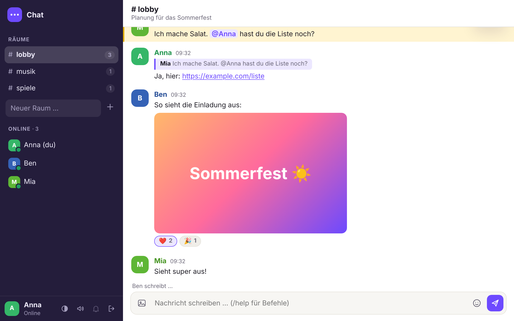
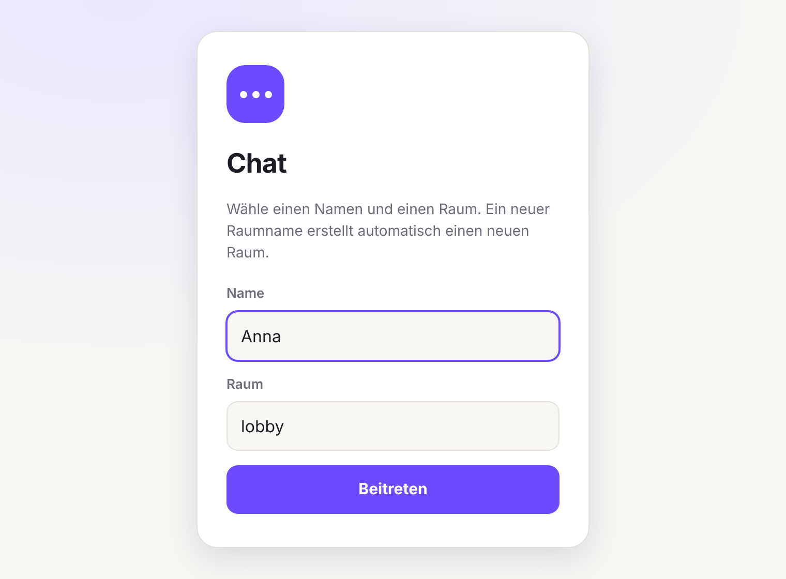
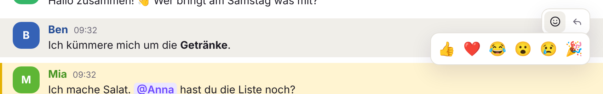
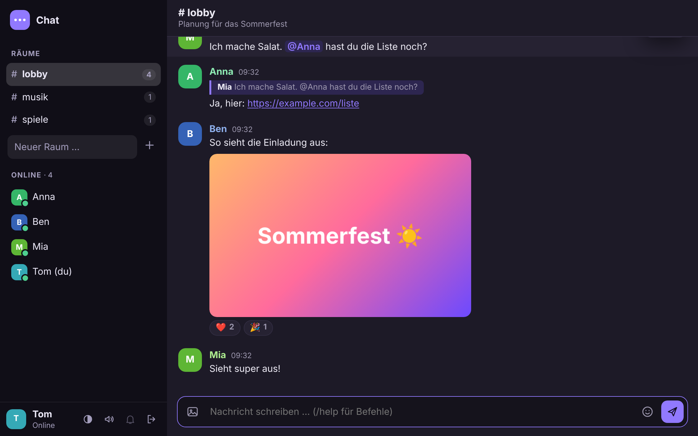
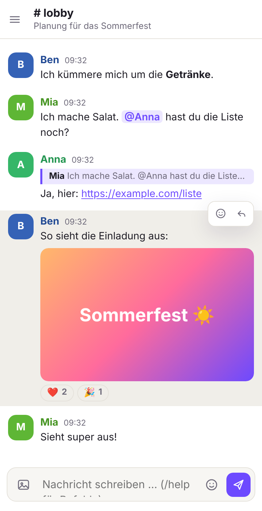
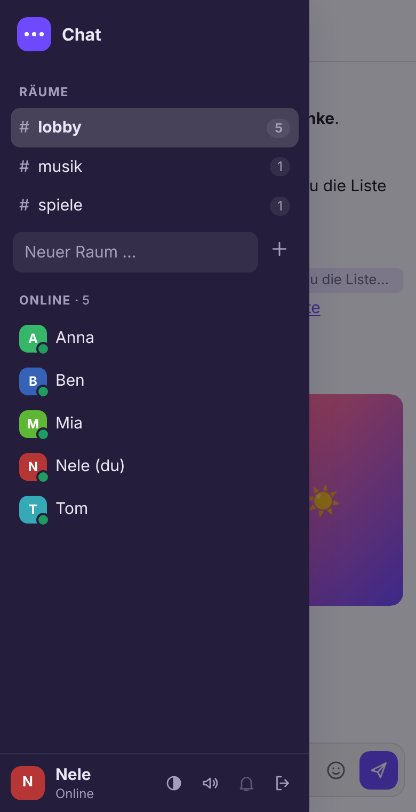

<div align="center">

# 💬 Chat – Bedienungsanleitung

**Alles, was du zum Chatten brauchst – und alles, um den Server selbst zu betreiben.**



</div>

> Diese Anleitung gibt es auch als gestaltete Seite direkt im Chat: Klicke dort oben rechts auf das Fragezeichen oder öffne `/anleitung.html`.

## Inhalt

**Teil 1 · Chatten**

1. [Beitreten](#1-beitreten)
2. [Die Oberfläche](#2-die-oberfläche)
3. [Nachrichten schreiben](#3-nachrichten-schreiben)
4. [Antworten, reagieren, bearbeiten, löschen](#4-antworten-reagieren-bearbeiten-löschen)
5. [Bilder senden](#5-bilder-senden)
6. [Räume](#6-räume)
7. [Privatnachrichten und Erwähnungen](#7-privatnachrichten-und-erwähnungen)
8. [Befehle](#8-befehle)
9. [Tastenkürzel](#9-tastenkürzel)
10. [Einstellungen](#10-einstellungen)
11. [Am Handy](#11-am-handy)

**Teil 2 · Server betreiben**

12. [Start mit Docker](#12-start-mit-docker)
13. [Ohne Docker auf Linux](#13-ohne-docker-auf-linux)
14. [Konfiguration](#14-konfiguration)
15. [Admin-Rechte](#15-admin-rechte)
16. [Ins Internet stellen](#16-ins-internet-stellen)
17. [Backup und Update](#17-backup-und-update)

**Hilfe** · [Häufige Fragen](#häufige-fragen)

---

# Teil 1 · Chatten

## 1. Beitreten

Öffne die Adresse des Chats im Browser. Du brauchst kein Konto und kein Passwort.

1. Gib einen **Namen** ein: 2 bis 20 Zeichen aus Buchstaben, Ziffern, `.`, `-` und `_`, ohne Leerzeichen.
2. Wähle einen **Raum**. Voreingestellt ist `lobby`. Gibst du einen Namen ein, den es noch nicht gibt, entsteht ein neuer Raum.
3. Klicke auf **Beitreten**.

<p align="center"></p>

> **Name schon vergeben?** Jeder Name kann nur einmal gleichzeitig online sein. Wähle einfach einen anderen. Dein Browser merkt sich Namen und Raum für das nächste Mal.

## 2. Die Oberfläche

| Bereich | Was du dort findest |
| --- | --- |
| 🗂️ **Links: Räume** | Alle Räume mit der Zahl der Personen, die gerade dort sind. Ein Klick wechselt den Raum. |
| 🟢 **Links: Online** | Wer im aktuellen Raum ist. Ein Klick auf einen Namen beginnt eine Privatnachricht. |
| 💬 **Mitte: Nachrichten** | Der Verlauf des Raums. Oben steht der Raumname mit seinem Thema. |
| ⌨️ **Unten: Eingabe** | Hier schreibst du. Links das Bild-Symbol, rechts Emojis und Senden. |
| ⚙️ **Unten links: Du** | Dein Name und die Schalter für Design, Ton, Benachrichtigungen und Abmelden. |

## 3. Nachrichten schreiben

Tippe unten ins Eingabefeld und drücke <kbd>Enter</kbd>. Für eine neue Zeile innerhalb der Nachricht drückst du <kbd>Umschalt</kbd> + <kbd>Enter</kbd>.

Mit ein paar Zeichen kannst du Text hervorheben:

| Du schreibst | Es erscheint |
| --- | --- |
| `**wichtig**` | **wichtig** |
| `*betont*` | *betont* |
| `~~erledigt~~` | ~~erledigt~~ |
| `` `npm start` `` | `npm start` |
| ` ``` ` … ` ``` ` | Ein mehrzeiliger Codeblock |
| `https://example.com` | Ein klickbarer Link |
| `@Anna` | Eine Erwähnung – Anna wird benachrichtigt |

Über das Smiley-Symbol rechts im Eingabefeld fügst du Emojis ein. Wenn jemand gerade tippt, siehst du das über dem Eingabefeld.

## 4. Antworten, reagieren, bearbeiten, löschen

Fahre mit der Maus über eine Nachricht (am Handy: tippe sie an). Rechts oben erscheinen kleine Symbole:

<p align="center"></p>

| Symbol | Was es tut |
| --- | --- |
| 😊 **Reagieren** | Öffnet sechs Emojis. Ein Klick setzt deine Reaktion, ein zweiter Klick auf dieselbe Reaktion nimmt sie zurück. |
| ↩ **Antworten** | Deine nächste Nachricht zitiert diese Nachricht. Ein Klick auf das Zitat springt später zum Original. |
| ✏️ **Bearbeiten** | Nur bei eigenen Nachrichten. Der Text landet im Eingabefeld; <kbd>Enter</kbd> speichert, <kbd>Esc</kbd> bricht ab. Bearbeitete Nachrichten tragen den Hinweis „(bearbeitet)". |
| 🗑 **Löschen** | Nur bei eigenen Nachrichten (Admins: bei allen). Die Nachricht verschwindet für alle und lässt sich nicht wiederherstellen. |

## 5. Bilder senden

Es gibt drei Wege:

- auf das **Bild-Symbol** links im Eingabefeld klicken und eine Datei wählen,
- ein Bild aus der **Zwischenablage einfügen** (<kbd>Strg</kbd> + <kbd>V</kbd>), zum Beispiel einen Screenshot,
- eine Bilddatei mit der Maus **ins Chatfenster ziehen**.

Steht beim Hochladen Text im Eingabefeld, wird er als Bildunterschrift mitgeschickt. Ein Klick auf ein Bild zeigt es groß.

> Erlaubt sind PNG, JPEG, GIF und WebP bis 5 MB – sofern der Betreiber nichts anderes eingestellt hat. Fehlt das Bild-Symbol, sind Bilder auf diesem Server abgeschaltet.

## 6. Räume

- **Wechseln:** links auf einen Raum klicken oder `/join raumname` schreiben.
- **Neu erstellen:** links unter der Raumliste einen Namen in „Neuer Raum …" eintippen und <kbd>Enter</kbd> drücken. Erlaubt sind Buchstaben, Ziffern, `-` und `_`.
- **Thema setzen:** oben auf die Zeile unter dem Raumnamen klicken oder `/topic Text` schreiben.
- **Einladen:** die Adresse aus dem Browser kopieren. Sie endet auf `#raumname` und führt direkt in diesen Raum.
- **Ältere Nachrichten:** ganz nach oben scrollen und auf „Ältere Nachrichten laden" klicken.

> ⚠️ **Räume sind offen.** Jeder, der den Chat erreicht, kann jeden Raum betreten und den Verlauf lesen. Schreibe nichts hinein, was nicht alle sehen dürfen.

## 7. Privatnachrichten und Erwähnungen

**Privat schreiben:** Klicke links auf einen Namen oder schreibe `/msg Name Text`. Die Nachricht sehen nur ihr beide. Sie erscheint mit einem Schloss 🔒 im Verlauf und funktioniert auch, wenn die andere Person in einem anderen Raum ist.

**Jemanden erwähnen:** Schreibe `@Name`. Die Nachricht wird bei dieser Person gelb hervorgehoben, und sie bekommt einen Ton und – wenn eingeschaltet – eine Benachrichtigung.

> Privatnachrichten werden nicht gespeichert. Nach dem Neuladen der Seite sind sie weg, und wer offline ist, bekommt sie nicht.

## 8. Befehle

Befehle beginnen mit einem Schrägstrich und werden wie eine Nachricht abgeschickt.

| Befehl | Wirkung |
| --- | --- |
| `/help` | Zeigt alle Befehle im Chat an |
| `/nick Name` | Ändert deinen Namen |
| `/me Text` | Sendet eine Aktion, z. B. `/me winkt` wird zu *Anna winkt* |
| `/msg Name Text` | Privatnachricht |
| `/join Raum` | Wechselt den Raum oder erstellt ihn |
| `/topic Text` | Setzt das Thema des Raums (ohne Text: entfernt es) |
| `/shrug` | Sendet ¯\\\_(ツ)\_/¯ |
| `/clear` | Leert nur deine eigene Ansicht |
| `/admin Passwort` | Holt Admin-Rechte (siehe [Abschnitt 15](#15-admin-rechte)) |

Soll eine Nachricht wirklich mit einem Schrägstrich beginnen, schreibe zwei: `//so`.

## 9. Tastenkürzel

| Taste | Wirkung |
| --- | --- |
| <kbd>Enter</kbd> | Nachricht senden |
| <kbd>Umschalt</kbd> + <kbd>Enter</kbd> | Neue Zeile |
| <kbd>Tab</kbd> | Angefangenen Namen vervollständigen, z. B. `be` zu `@Ben` |
| <kbd>↑</kbd> bei leerem Feld | Deine letzte Nachricht bearbeiten |
| <kbd>Esc</kbd> | Antwort oder Bearbeitung abbrechen, Fenster schließen |

## 10. Einstellungen

Unten links neben deinem Namen sitzen vier Schalter:

| Schalter | Wirkung |
| --- | --- |
| ◐ **Design** | Wechselt zwischen automatisch (wie dein Gerät), hell und dunkel |
| 🔊 **Ton** | Kurzer Ton bei Erwähnungen und Privatnachrichten |
| 🔔 **Benachrichtigungen** | Meldung des Browsers, wenn der Chat im Hintergrund ist. Beim ersten Einschalten fragt der Browser nach deiner Erlaubnis. |
| ⇥ **Abmelden** | Verlässt den Chat und gibt deinen Namen frei |

<p align="center"></p>

Ungelesene Nachrichten zählt der Chat im Titel des Browser-Tabs mit, zum Beispiel „(3) #lobby". Bricht die Verbindung ab, verbindet er sich von selbst neu.

## 11. Am Handy

Der Chat läuft im Browser des Handys, eine App ist nicht nötig. Räume, Personen und Einstellungen erreichst du über das Menü-Symbol ☰ oben links.

<p align="center">

&nbsp;&nbsp;

</p>

Tipp: Über „Zum Startbildschirm hinzufügen" im Browser-Menü legst du dir den Chat wie eine App ab.

---

# Teil 2 · Server betreiben

## 12. Start mit Docker

Der einfachste Weg. Du brauchst nur Docker mit Compose.

```bash
git clone https://github.com/Noi922/chat.git
```

```bash
cd chat
```

```bash
docker compose up -d
```

Danach läuft der Chat unter `http://localhost:3000`. Andere Geräte im selben Netz erreichen ihn über die IP-Adresse deines Rechners, zum Beispiel `http://192.168.1.20:3000`.

| Aufgabe | Befehl |
| --- | --- |
| Stoppen | `docker compose down` |
| Logs ansehen | `docker compose logs -f` |
| Neu starten | `docker compose restart` |

Verlauf und Bilder liegen im Volume `chat-data` und bleiben beim Stoppen und Aktualisieren erhalten.

## 13. Ohne Docker auf Linux

Das Installationsskript richtet den Chat als Systemdienst ein. Es erkennt die Paketmanager von Debian/Ubuntu, Fedora/RHEL, Arch, openSUSE und Alpine und installiert bei Bedarf Node.js (nötig ist Version 18 oder neuer).

```bash
sudo ./install.sh
```

| Was | Wo |
| --- | --- |
| Programm | `/opt/chat-server` |
| Einstellungen | `/etc/chat-server.env` |
| Daten | `/var/lib/chat-server` |
| Status | `systemctl status chat-server` |
| Logs | `journalctl -u chat-server -f` |

Nur zum Ausprobieren reicht auch `npm install` und `npm start` im Projektordner.

## 14. Konfiguration

**Mit Docker:** Kopiere `.env.example` nach `.env`, passe die Werte an und starte mit `docker compose up -d` neu.

**Ohne Docker:** Bearbeite `/etc/chat-server.env` und führe `sudo systemctl restart chat-server` aus.

| Einstellung | Standard | Bedeutung |
| --- | --- | --- |
| `PORT` | `3000` | Port des Chats |
| `SERVER_NAME` | `Chat` | Name, der im Browser erscheint |
| `ADMIN_PASSWORD` | leer | Passwort für Admin-Rechte; leer heißt: keine Admins |
| `ENABLE_UPLOADS` | `true` | Bilder erlauben |
| `MAX_UPLOAD_MB` | `5` | Größte erlaubte Bilddatei |
| `HISTORY_SIZE` | `1000` | Gespeicherte Nachrichten pro Raum |
| `MAX_MESSAGE_LENGTH` | `2000` | Zeichen pro Nachricht |
| `MAX_ROOMS` | `100` | Höchstzahl an Räumen |
| `TRUST_PROXY` | `false` | Auf `true` setzen, wenn ein Reverse-Proxy davor sitzt |

Die vollständige Liste steht in der [README](README.md#konfiguration).

## 15. Admin-Rechte

1. Setze in der Konfiguration ein Passwort: `ADMIN_PASSWORD=ein-langes-passwort`, dann den Server neu starten.
2. Schreibe im Chat `/admin ein-langes-passwort`. Die Zeile wird nicht als Nachricht gesendet.
3. Neben deinem Namen steht jetzt „Admin".

| Als Admin kannst du | So geht es |
| --- | --- |
| Fremde Nachrichten löschen | Papierkorb-Symbol an der Nachricht |
| Jemanden hinauswerfen | `/kick Name` |
| Einen leeren Raum samt Verlauf löschen | `/delroom Raum` |

> ⚠️ **Grenzen kennen.** Die Admin-Rechte gelten, bis du die Seite verlässt. Wer hinausgeworfen wurde, kann unter demselben oder einem anderen Namen wieder beitreten – eine dauerhafte Sperre gibt es nicht.

## 16. Ins Internet stellen

Der Server spricht nur unverschlüsseltes HTTP. Für den Betrieb im Internet gehört ein Reverse-Proxy mit HTTPS davor. Mit Caddy genügt diese Konfiguration, das Zertifikat holt Caddy selbst:

```
chat.example.com {
    reverse_proxy localhost:3000
}
```

Setze dann `TRUST_PROXY=true`. Ein Beispiel für Nginx steht in der [README](README.md#öffentlich-betreiben-https).

> ⚠️ **Der Chat hat keine Anmeldung.** Wer die Adresse kennt, kann mitlesen und mitschreiben. Für einen geschlossenen Kreis schützt du den Zugang im Reverse-Proxy (z. B. mit einem Passwort) oder lässt den Chat nur im eigenen Netz oder VPN laufen.

## 17. Backup und Update

**Backup:** Alles Wichtige liegt in einem Ordner – der Verlauf in `state.json`, die Bilder in `uploads`. Ohne Docker ist das `/var/lib/chat-server`. Mit Docker sicherst du das Volume so:

```bash
docker run --rm -v chat_chat-data:/data -v "$PWD":/backup alpine tar czf /backup/chat-backup.tar.gz -C /data .
```

**Update mit Docker:**

```bash
git pull
```

```bash
docker compose up -d --build
```

**Update ohne Docker:**

```bash
git pull
```

```bash
sudo ./install.sh
```

Einstellungen und Daten bleiben bei beiden Wegen erhalten.

---

## Häufige Fragen

<details>
<summary><b>Oben steht „Verbindung getrennt – verbinde neu …"</b></summary>

Die Verbindung zum Server ist abgebrochen. Der Chat versucht es von selbst weiter. Bleibt die Meldung, ist der Server nicht erreichbar oder – hinter Nginx – fehlen die Einstellungen für WebSockets.
</details>

<details>
<summary><b>Ich wurde abgemeldet mit „in einem anderen Tab angemeldet"</b></summary>

Du hast den Chat mit demselben Namen in einem zweiten Tab oder Fenster geöffnet. Es kann immer nur eines aktiv sein. Für zwei Fenster gleichzeitig brauchst du zwei verschiedene Namen.
</details>

<details>
<summary><b>Ich kann meine alten Nachrichten nicht mehr bearbeiten</b></summary>

Der Chat erkennt dich an einem Kennzeichen, das dein Browser speichert. In einem anderen Browser, auf einem anderen Gerät, im privaten Modus oder nach dem Löschen der Browserdaten bist du für den Server eine neue Person.
</details>

<details>
<summary><b>Ich bekomme keine Benachrichtigungen</b></summary>

Schalte die Glocke unten links ein und erlaube Benachrichtigungen, wenn der Browser fragt. Sie erscheinen nur bei Erwähnungen und Privatnachrichten und nur, wenn der Chat-Tab im Hintergrund ist. Manche Handy-Browser unterstützen sie nicht.
</details>

<details>
<summary><b>„Zu viele Nachrichten – bitte kurz warten"</b></summary>

Der Spam-Schutz erlaubt höchstens 8 Nachrichten in 5 Sekunden. Kurz warten, dann geht es weiter.
</details>

<details>
<summary><b>Wie lange bleiben Nachrichten gespeichert?</b></summary>

Pro Raum die letzten 1000 Nachrichten (einstellbar). Ältere werden automatisch entfernt, zusammen mit ihren Bildern.
</details>

<details>
<summary><b>Der Port 3000 ist schon belegt</b></summary>

Setze in der Konfiguration einen anderen Port, zum Beispiel `PORT=8080`, und starte neu.
</details>
